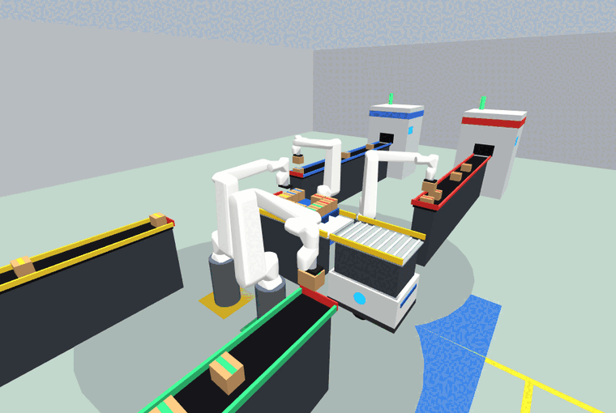
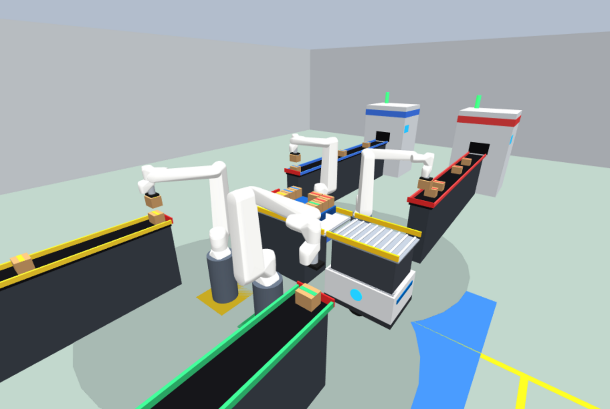
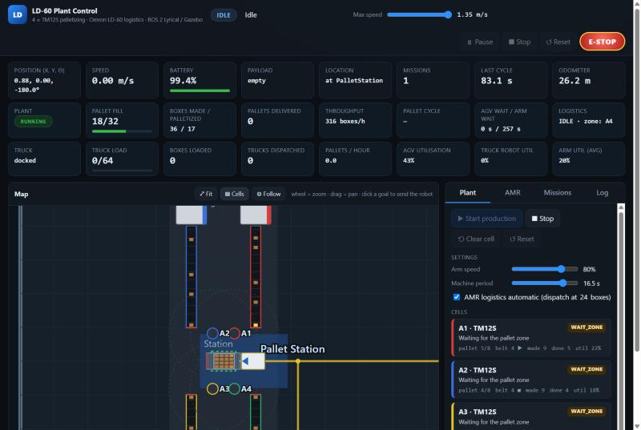
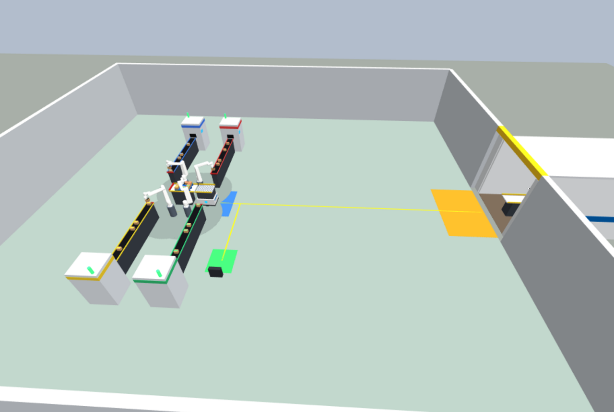
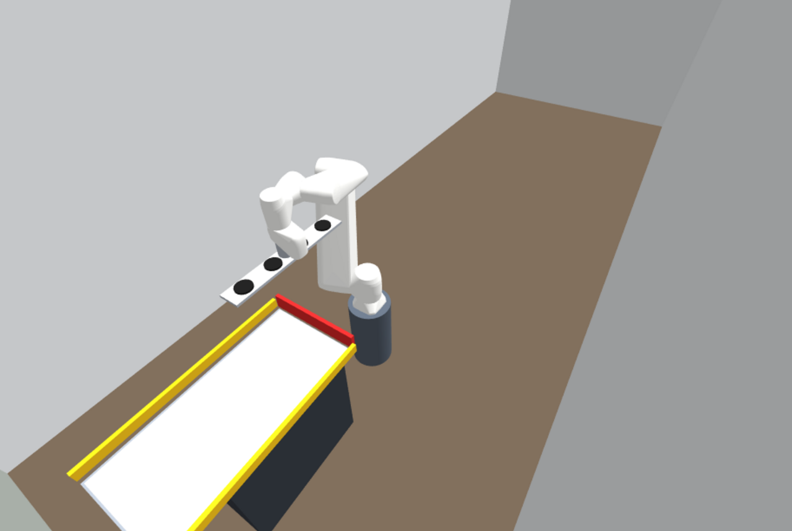
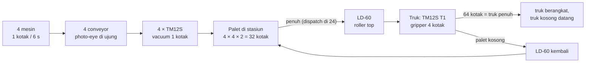
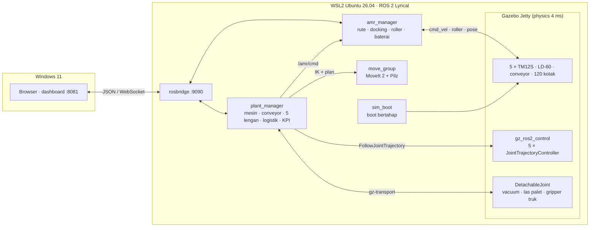

# LD-60 Palletizing Plant — Simulasi Pabrik ROS 2 (4 × TM12S + Omron LD-60 + Truck Loader)

**ROS 2 Lyrical · Gazebo Jetty · MoveIt 2 (Pilz PTP/LIN) · ros2_control · WSL2 (Windows 11)**

Simulasi lini produksi lengkap: **4 mesin** mencetak kotak ke **4 conveyor**, **4 robot Techman TM12S**
menyusun kotak ke **satu palet**, **AMR Omron LD-60** dengan *roller top* membawa palet ke **truk box**,
dan **TM12S ke-5 di dalam truk** dengan *gripper* 4 kotak memindahkan isi palet ke bak truk. Truk yang
penuh berangkat, truk kosong datang, palet kosong kembali — berulang terus. Semua dipantau dan
dikendalikan dari **dashboard web** bergaya MobilePlanner.

<p align="center">
  
</p>

| Sel palletizing | Dashboard (web) |
|---|---|
|  |  |

| Seluruh pabrik | Robot truk (T1) + gripper 4 kotak |
|---|---|
|  |  |

---

## Daftar isi
1. [Alur pabrik](#1-alur-pabrik)
2. [Robot-robotnya](#2-robot-robotnya)
3. [Layout](#3-layout)
4. [Arsitektur sistem](#4-arsitektur-sistem)
5. [Dashboard](#5-dashboard)
6. [Keselamatan & interlock](#6-keselamatan--interlock)
7. [Instalasi](#7-instalasi)
8. [Menjalankan](#8-menjalankan)
9. [Pengujian & hasil](#9-pengujian--hasil)
10. [Pelajaran — bug nyata yang ditemukan & diperbaiki](#10-pelajaran--bug-nyata-yang-ditemukan--diperbaiki)
11. [Struktur repo](#11-struktur-repo)
12. [Lisensi & kredit](#12-lisensi--kredit)

---

## 1. Alur pabrik



1. **Mesin** menaruh kotak ke conveyor (berhenti otomatis kalau conveyor sudah berisi 4 kotak).
2. **Conveyor** berjalan sampai kotak menyentuh *end stop* (photo-eye), lalu berhenti sampai kotak diambil.
3. **Robot A1–A4** mengambil kotak, menunggu palet tersedia, masuk **zona palet** (interlock), menaruh
   kotak di kuadrannya sendiri (8 kotak / robot, 2 lapis).
4. Saat palet berisi **24 kotak**, LD-60 sudah dikirim ke stasiun — begitu palet penuh (32), palet
   dimuat lewat **roller** (transfer ±7 s), dibawa ke **truk**, diturunkan ke roller station di truk.
5. **Robot truk T1** mengangkat **satu baris (4 kotak) sekaligus** dan menyusunnya di bak truk
   (2 sisi × 4 baris × 2 lapis = **64 kotak**). Truk penuh → berangkat, truk kosong datang.
6. LD-60 membawa **palet kosong** kembali ke stasiun; lalu parkir di Home (atau charging bila < 50 %).

---

## 2. Robot-robotnya

### Techman TM12S (5 unit)
Model 3D resmi Techman (`tm_description`, [TechmanRobotInc/tm2_ros2](https://github.com/TechmanRobotInc/tm2_ros2)).

| Parameter | Nilai |
|---|---|
| Sumbu | 6 (revolute) · reach ±1300 mm · payload 12 kg |
| Kecepatan sendi maks | J1/J2 130°/s · J3 210°/s · J4/J5 225°/s · J6 450°/s (planning memakai 90 %) |
| Pemasangan | pedestal 0,5 m (dari lantai pergelangan tidak bisa mencapai tinggi palet dengan tool menghadap bawah — dicek dengan `tools/cell_reach2.py`) |
| A1–A4 | vacuum cup 120 × 80 mm, TCP 100 mm dari flange |
| T1 (truk) | **bar 4 cup** 580 × 90 mm (pitch 145 mm = pitch kotak di palet), TCP 100 mm dari flange |

| Sel | Base (x, y) m | Conveyor | Kuadran palet | Warna |
|---|---|---|---|---|
| A1 | (0.32, 0.82) | (0.95, 4.0) → (0.95, 1.0) | +x, +y | merah |
| A2 | (−0.32, 0.82) | (−0.95, 4.0) → (−0.95, 1.0) | −x, +y | biru |
| A3 | (−0.32, −0.82) | (−0.95, −4.0) → (−0.95, −1.0) | −x, −y | kuning |
| A4 | (0.32, −0.82) | (0.95, −4.0) → (0.95, −1.0) | +x, −y | hijau |
| T1 | (14.15, 0.0) menghadap −x | — | baris palet → bak truk | oranye |

### Omron LD-60 (AMR)
| | |
|---|---|
| Badan | 699 × 500 × 383 mm, 62 kg, diferensial (roda Ø200 mm, track 420 mm), 4 caster |
| Top module | roller top, deck 680 × 480 mm di 750 mm, side guide, pallet lock |
| Batas gerak | dari map MobilePlanner asli lokasi training: 1,35 m/s maks, akselerasi 0,3–0,4 m/s², rotasi 140°/s, toleransi goal 30 mm / 2° |
| Lokalisasi | *ground truth* Gazebo, rute tetap tanpa lidar (dipilih demi performa) |
| Docking | segmen terakhir lurus (pure pursuit), approach 0,15 m/s, toleransi berhenti 8 mm — hasil **3–8 mm, < 0,3°** |

### Barang
Kotak 130 × 100 × 100 mm, 1 kg · palet 600 × 450 × 80 mm · pola 4 × 4 × 2 dengan celah 15 / 10 mm.

---

## 3. Layout

Hall 18 × 16 m (x −6…12,2, y ±8) dengan pintu dock ke truk box (bak 6,8 × 2,4 m).

| Goal LD-60 | Pose (x, y, θ) | Keterangan |
|---|---|---|
| Home / Charger | 2.20, −3.00, 90° | mundur ke charger |
| Pallet Station | 0.87, 0.00, 180° | docking ke roller station palet |
| Truck Dock | 12.33, 0.00, 0° | masuk pintu truk, docking ke roller station truk |

Semua parameter (sel, pola palet, kecepatan, ambang dispatch, kapasitas truk…) ada di
[`config/plant.yaml`](plant_ws/src/ld60_plant/config/plant.yaml); world Gazebo, URDF 5 lengan, dan
konfigurasi MoveIt **dibangkitkan otomatis** dari file itu (`tools/gen_arms.py`, `world_gen.py`).

---

## 4. Arsitektur sistem



| Komponen | Fungsi |
|---|---|
| **plant_manager** | Mesin & conveyor (10 Hz), 4 sel palletizing + robot truk (IK MoveIt, Pilz PTP/LIN), interlock zona palet, logistik AMR otomatis, truk berangkat/datang, KPI, `/plant/*` |
| **amr_manager** | Graf rute (Dijkstra), pure pursuit, docking presisi, transfer roller dengan *stall watchdog*, baterai & charging, misi, Pause/Stop/E-STOP, `/amr/*` |
| **sim_boot** | Boot bertahap: world → lengan → bar gripper truk; tiap grup *DetachableJoint* dilepas & dikonfirmasi lewat topik state sebelum simulasi berjalan |
| **Dashboard** | HTML/JS murni lewat rosbridge, tidak perlu install apa pun di Windows |

**Waktu:** semua timeout, watchdog, dan KPI memakai **waktu simulasi** — kalau laptop lambat (atau
*throttling*), pabrik ikut melambat dengan benar, tidak gagal.

---

## 5. Dashboard

Buka **http://localhost:8081** setelah simulasi jalan.

| Bagian | Isi |
|---|---|
| KPI AMR | posisi, kecepatan, baterai, payload, lokasi, misi, cycle terakhir, odometer |
| KPI pabrik | isi palet, kotak dibuat/disusun, palet terkirim, throughput, cycle palet, waktu tunggu AGV/lengan, status logistik + pemilik zona |
| KPI truk | status truk, muatan (x/64), kotak dimuat, truk terkirim, palet/jam, utilisasi AGV, robot truk, rata-rata lengan |
| Peta | hall, rute, zona, sel, conveyor, kotak live (berwarna per jalur), posisi AMR & palet, tombol **Fit / Cells / Follow**, klik goal untuk mengirim AMR |
| Tab Plant | Start/Stop/Clear/Reset, kecepatan lengan, periode mesin, logistik otomatis on/off, kartu status tiap sel + robot truk |
| Tab AMR / Missions / Log | kontrol manual AMR, misi *Pallet cycle* (bisa loop), log gabungan |

> Selama produksi berjalan dengan logistik otomatis, perintah manual AMR dikunci (kecuali Pause, Stop,
> E-STOP, Reset) supaya tidak "mencuri" palet dari sel.

---

## 6. Keselamatan & interlock

* **Zona palet (interlock adil):** lengan yang kuadrannya bersebelahan tidak pernah bekerja di atas palet
  bersamaan; pasangan diagonal (A1+A3, A2+A4) boleh — dilayani urut kedatangan (tanpa *starvation*).
* **Logistik mengunci zona** sebelum palet diangkat; lengan baru menaruh lagi setelah palet kembali.
* **Setiap gerak dicek tabrakan** oleh MoveIt: stasiun, conveyor, mesin, dinding/atap truk, area docking
  AMR (*keep-out*), dan baris kotak yang sudah tersusun di truk.
* **Photo-eye & belt hold:** conveyor berhenti selama kotak diangkat (kotak berikutnya tidak menjepit).
* **Vacuum check:** setelah angkat, posisi kotak diverifikasi; 1× *re-pick* otomatis, lalu stop dengan pesan jelas.
* **Gripper truk:** 4 kotak diverifikasi setelah diangkat; baris dibawa lewat pose *home* agar tidak
  menyapu baris yang masih di palet.
* **AMR:** watchdog transfer roller (palet macet → error jelas), E-STOP/Pause/Stop dari dashboard.
* **Kotak jatuh** otomatis dikembalikan ke mesin, termasuk saat status ERROR (fisika tidak tersendat).

---

## 7. Instalasi

Diuji di **Windows 11 + WSL2 Ubuntu 26.04 + ROS 2 Lyrical**, laptop i7-13620H / Intel UHD.

```bash
# paket ROS (di Ubuntu)
sudo apt install ros-lyrical-desktop ros-dev-tools ros-lyrical-ros-gz ros-lyrical-moveit \
  ros-lyrical-gz-ros2-control ros-lyrical-ros2-controllers ros-lyrical-rosbridge-suite ros-lyrical-xacro

# build
git clone https://github.com/Keyzoo0/ld60-palletizing-plant.git
cp -r ld60-palletizing-plant/plant_ws ~/plant_ws
cd ~/plant_ws && source /opt/ros/lyrical/setup.bash
colcon build --symlink-install
```

Rekomendasi `.wslconfig`: [`setup/wslconfig.example`](setup/wslconfig.example) (12 thread, 9 GB RAM).

---

## 8. Menjalankan

**Dari Windows:** salin folder [`windows/`](windows), jalankan `make_shortcuts.ps1` → ikon
**LD-60 Pabrik Simulasi**, **(Ringan)** dan **Stop Simulasi**. Dashboard terbuka otomatis.

**Dari terminal:**
```bash
~/plant_ws/run_plant.sh                  # Gazebo + dashboard
~/plant_ws/run_plant.sh gz_gui:=false    # tanpa jendela Gazebo (lebih ringan)
~/plant_ws/run_plant.sh rviz:=true       # + RViz (tampilan MoveIt)
```
Buka **http://localhost:8081** → tab **Plant** → **Start production**.

---

## 9. Pengujian & hasil

```bash
cd ~/plant_ws/src/ld60_plant && python3 -m pytest -q test        # rute & kontroler AMR (8)
~/plant_ws/tools/soak.sh --fill --pallets 2                      # soak penuh + log RTF/CPU
python3 -m ld60_plant.mission_check --cycles 6                   # misi AMR saja
```
`plant_check` (dipakai `soak.sh`) menekan Start, mengikuti semua status, dan gagal pada error pertama,
timeout, atau kalau `/plant/state` berhenti. `--fill` memulai dengan palet penuh supaya rantai
AMR → truk langsung teruji.

| Uji | Hasil |
|---|---|
| Unit test rute & kontroler | **8/8 lulus** |
| Soak 2 palet (produksi → AMR → T1 → truk penuh berangkat → truk baru → palet kembali) | **lulus tanpa warning** |
| Robot truk T1 | **≈ 108 s / palet** (8 baris × 4 kotak) |
| Docking LD-60 | **3–8 mm, < 0,3°** · transfer roller ≈ 6–7 s |
| Real-time factor | **≈ 0,8** (5 lengan, 120 kotak) pada laptop dingin |

> **Catatan laptop:** pada laptop uji, CPU *throttling* ke ±35 % setelah 10–20 menit beban terus-menerus
> (RTF turun ke 0,03–0,1). Karena semua logika memakai waktu simulasi, soak tetap **lulus** — hanya lebih
> lambat. `soak.sh` mencatat benchmark CPU di samping RTF supaya ini terlihat.

---

## 10. Pelajaran — bug nyata yang ditemukan & diperbaiki

| Masalah | Penyebab | Perbaikan |
|---|---|---|
| Palet macet saat hand-over (acak) | caster 2 mm di atas lantai → robot miring 0,42°, tepi deck mengait palet | caster di lantai, stasiun selevel robot, runner palet dibulatkan, stall watchdog |
| Lengan tertarik saat start | *DetachableJoint* langsung menempel saat world dimuat | world mulai *paused*; joint dilepas & dikonfirmasi sebelum jalan |
| RTF 0,15 saat palet penuh | 32 kotak bertumpuk = satu LCP kontak besar | kotak yang ditaruh di-**las** ke palet, dilepas di truk |
| Kotak bertabrakan di palet | titik pick nominal 12 mm dari posisi kotak sebenarnya | pick di posisi kotak terukur (photo-eye) + celah antar kotak |
| Joint 3 terseret saat angkat | conveyor jalan lagi & menjepit kotak ke end stop | belt ditahan sampai kotak terangkat |
| A2 tidak pernah dapat giliran | `Lock` Python tidak adil | interlock zona adil + pasangan diagonal paralel |
| Boot lambat & fisika meledak | 3 joint menempel ke 1 kotak bersamaan → 238 "welded mirror" di DART | boot bertahap, bar gripper truk jadi model terpisah |
| Joint "nyangkut" acak | pesan gz-transport hilang sebelum subscriber ditemukan (ratusan topik) | tunggu `has_connections()`, re-advertise dari node baru |
| T1 menyapu baris di palet | ayunan PTP turun saat masih di atas palet | baris diangkat lewat pose home |
| Pergelangan T1 menabrak tumpukan | baris disusun kolom-per-kolom | susun **lapis per lapis** |
| Error palsu saat laptop lambat | timeout & cek pose memakai jam dinding | semua memakai waktu simulasi; tunggu pesan pose/state *baru* |
| AMR 70 % CPU | mem-parse pose seluruh pabrik 50×/s | PosePublisher per model (AMR & palet) → 10 % |

---

## 11. Struktur repo

```
plant_ws/
  run_plant.sh
  src/ld60_plant/
    config/plant.yaml          # SEMUA parameter pabrik
    config/arms/               # controller & MoveIt (dibangkitkan)
    urdf/                      # 5 × TM12S + gripper (dibangkitkan)
    models/                    # LD-60, palet, roller station, truk
    worlds/plant.sdf           # template hall (sel dibangkitkan saat launch)
    launch/plant.launch.py
    ld60_plant/plant_manager.py   amr_manager.py   route.py   sim_boot.py
               world_gen.py       plant_check.py   mission_check.py   web_server.py
    web/                       # dashboard
    test/
  src/tm_description/          # model resmi Techman (hanya TM12S)
  tools/gen_arms.py  truck_reach.py  cell_reach2.py  soak.sh
windows/                       # launcher .bat + ikon
setup/wslconfig.example
docs/images/
```

---

## 12. Lisensi & kredit

* Kode proyek ini: **BSD-3-Clause** ([LICENSE](LICENSE)).
* `plant_ws/src/tm_description`: model resmi **Techman Robot Inc.**, BSD-3-Clause, dipangkas hanya TM12S.
* TM12S/TMflow adalah merek Techman Robot Inc.; Omron, LD-60, MobilePlanner adalah merek OMRON
  Corporation. Proyek belajar independen, tidak berafiliasi dengan Techman maupun Omron.

Proyek terkait: [TM12S Flow Studio](https://github.com/Keyzoo0/tm12s-ros2-flow-studio).

Dibuat oleh **Ahmad Zainul Arifin** ([@Keyzoo0](https://github.com/Keyzoo0)) — training robotika
Omron/Techman, PT ELMCECON.
